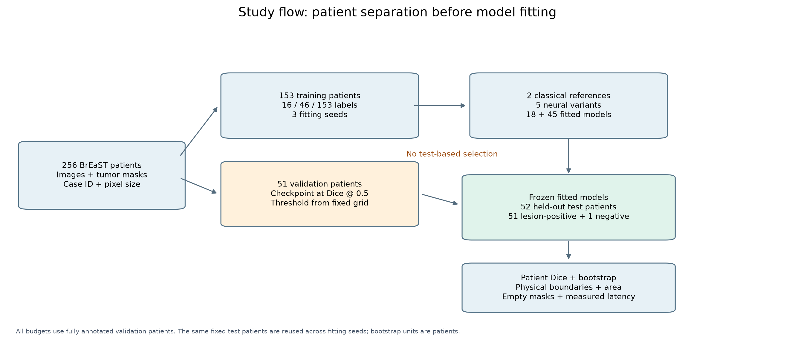
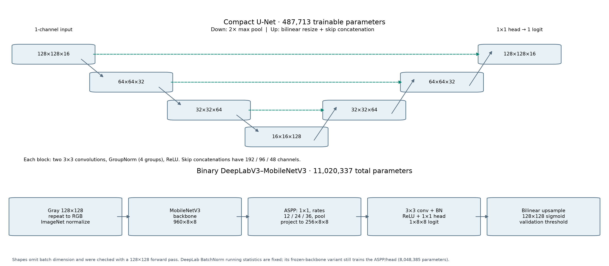
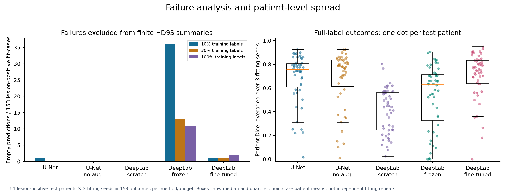

# Breast ultrasound segmentation under limited annotation

How much do model initialization and annotation budget change lesion segmentation on a small, patient-separated ultrasound cohort?

This repository compares classical pixel models, a compact U-Net, and scratch/pretrained DeepLabV3–MobileNetV3 on the public **BrEaST** dataset. The recorded experiment is complete: **256 verified cases, 18 classical fits, 45 neural fits, three seeds, and three training-label budgets**. Its conclusions are limited to one fixed cohort and split; external generalization has not been established.



## What the experiment found

At the full training-label budget, the lesion-positive test results were:

| Method | Patient Dice, mean [95% bootstrap interval] | Empty masks / 153 patient–fit outcomes |
|---|---:|---:|
| Pixel logistic regression | 0.226 [0.184, 0.272] | 0 |
| Local-feature random forest | 0.485 [0.428, 0.547] | 0 |
| U-Net | 0.685 [0.622, 0.742] | 0 |
| U-Net without augmentation | 0.679 [0.609, 0.743] | 0 |
| DeepLab, scratch | 0.406 [0.356, 0.458] | 0 |
| DeepLab, frozen pretrained backbone | 0.526 [0.450, 0.601] | 11 |
| DeepLab, fine-tuned | 0.706 [0.646, 0.759] | 2 |

The full-label paired U-Net-minus-fine-tuned-DeepLab difference was **−0.020 [−0.068, 0.027]**. That interval does not identify a clear winner. Each patient is averaged across the three fitted seeds before patients are resampled; the interval conditions on this cohort/split.

With only 16 labeled training patients, fine-tuned DeepLab reached Dice 0.583 versus 0.460 for U-Net. Frozen-backbone DeepLab produced **36 empty lesion masks among 153 outcomes** at that budget. Its finite HD95 median must therefore be read alongside its failures.


The latency panel measures warmed, synchronized MPS forward passes on an already prepared batch-one tensor. Loading, resizing and transfer are excluded. See the [complete neural table](results/neural/REPORT.md), [paired/failure analysis](results/neural/ANALYSIS.md), and [classical results](results/pilot/REPORT.md).

## Data and quality control

BrEaST contains one scan from each of 256 patients according to its data descriptor. Case IDs define the split: **153 training / 51 validation / 52 test**. Four cases have no tumor mask; the test set contains 51 lesion-positive cases and one mask-negative case. That one case supports a false-foreground check, not a population specificity estimate.

Images are converted to grayscale and resized to 128×128; masks use nearest-neighbor resizing. The tumor annotation is the target. Other-object annotations, age, diagnosis and BI-RADS do not enter the model. Every archive member, metadata case and referenced image/mask is checked before evaluation.


The metadata supplies native `Pixel_size` in **centimeters per pixel**. After resizing, spacing is computed separately on each axis. HD95 is in millimeters and area error in square millimeters; neither is inferred from PNG DPI. The [physical-unit audit](GEOMETRY_AUDIT.md) records the definition, conversion, checks and limitations.

Source images and masks: **BrEaST / Pawłowska et al. (2024), TCIA, [DOI 10.7937/9WKK-Q141](https://doi.org/10.7937/9WKK-Q141), CC BY 4.0**. The displayed figures resize/overlay those inputs. Attribution, original URLs and checksum pins are in [DATA.md](DATA.md). Raw images and the clinical workbook are excluded from Git.

## Models and selection

The compact U-Net has **487,713 parameters**, GroupNorm blocks and bilinear upsampling with skip concatenation. DeepLab has **11,020,337 parameters**, a MobileNetV3 backbone, ASPP and a replaced binary head. Architecture shapes below were checked against an actual 128×128 forward pass.



Three fitting seeds share nested budgets of **16 / 46 / 153 annotated training patients**. Every budget retains fully labeled validation patients. Neural training uses AdamW, BCE plus soft Dice, batch four, at most 60 epochs and validation-only early stopping. U-Net uses learning rate 0.001; DeepLab uses 0.0001. Augmentation pairs image/mask flips, with image-only gamma and multiplicative speckle.

The checkpoint is selected using validation lesion-positive Dice at threshold 0.5. A global foreground threshold is then selected from a fixed five-value validation grid. The test set chooses neither. See [NEURAL_PROTOCOL.md](NEURAL_PROTOCOL.md), [PROTOCOL.md](PROTOCOL.md) and the exact [configuration](configs/neural.json).

**Interpretation caveat:** all DeepLab variants freeze BatchNorm running statistics. The scratch model keeps initial statistics; pretrained models keep learned ones. Along with different learning rates and capacity, this prevents interpreting the comparison as an isolated causal effect of pretraining. The 128-pixel recipe also differs from the pretrained model’s original input recipe.

## Inspect the masks and failures


Green marks the reference boundary; rose marks predicted foreground. These are actual inference replays from the preserved seed-zero/full-label checkpoints. Rows show the median U-Net case, the lowest-Dice frozen-backbone case, and the single mask-negative test case. Selection is post-run and descriptive; these images did not select training parameters. Checkpoint hashes, case IDs and replay-versus-saved metric checks are in [figure evidence](figures/evidence.json).



Finite boundary-distance summaries omit infinite distances from empty outputs while retaining their counts. The scatter uses one mean per patient, not three independent copies of each patient. Thresholded pixel scores are foreground scores, not malignancy probabilities.

## Reproduce

Use a separate Python 3.12 environment. The classical study and software checks run without a GPU:

```bash
python3.12 -m venv .venv
source .venv/bin/activate
pip install -r requirements.lock
pytest -q
python -m study --config configs/pilot.json --output results/reproduction-classical
```

For the neural stage, install the optional pinned [environment](requirements-neural.lock). On Linux CPU, install the matching official CPU PyTorch wheels after the base requirements:

```bash
pip install torch==2.15.0 torchvision==0.29.2 --index-url https://download.pytorch.org/whl/cpu
pytest -q
python -m study.neural --config configs/neural.json --output results/reproduction-neural
```

On Apple Silicon, the recorded environment used PyTorch 2.15.0 / torchvision 0.29.2 with MPS. The completed neural run took about 68.7 minutes on an M1 with 8 GiB RAM, including one documented temporary pause; that is an observed run time, not a hardware-independent estimate. Numerical determinism is requested but backend differences remain possible.

The archive is roughly 70 MB. Pretrained initialization downloads official torchvision weights into ignored `data/`. Local trained checkpoints are not distributed. For a detailed walk-through, source/output map and figure commands, read [MANUAL.md](MANUAL.md). [VALIDATION.md](VALIDATION.md) records the checks and [results/neural/evidence.json](results/neural/evidence.json) pins the executed source.

## Limits of this result

One small public cohort and one patient split do not establish hospital transfer or clinical utility. There is no external BUS-UCLM result, no native annotator-disagreement study, and only one mask-negative test case. Square resizing changes image geometry and loses boundary detail even when physical units are propagated correctly. The comparisons implement standard reference methods; they do not introduce a new architecture.
