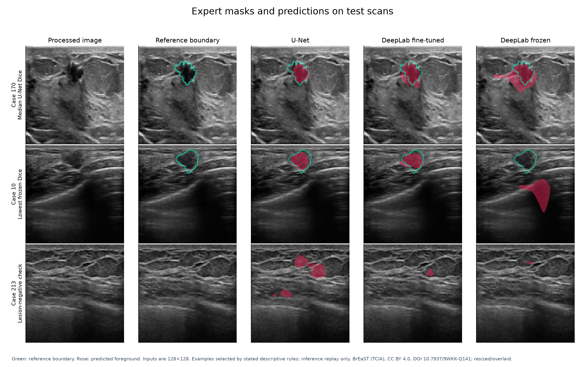
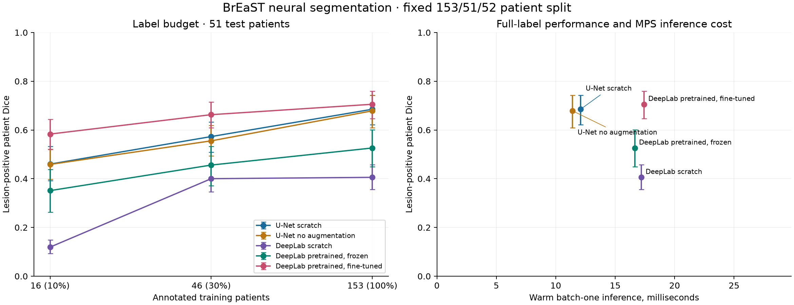
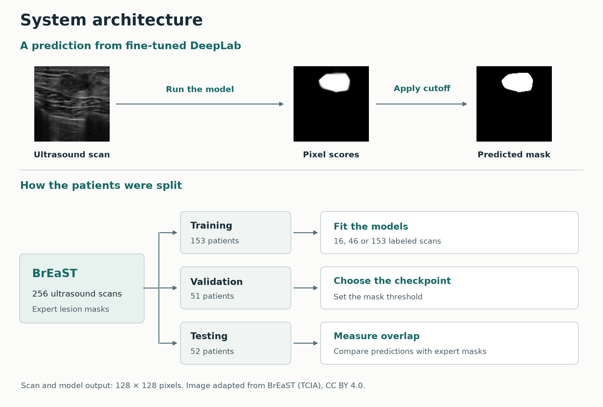
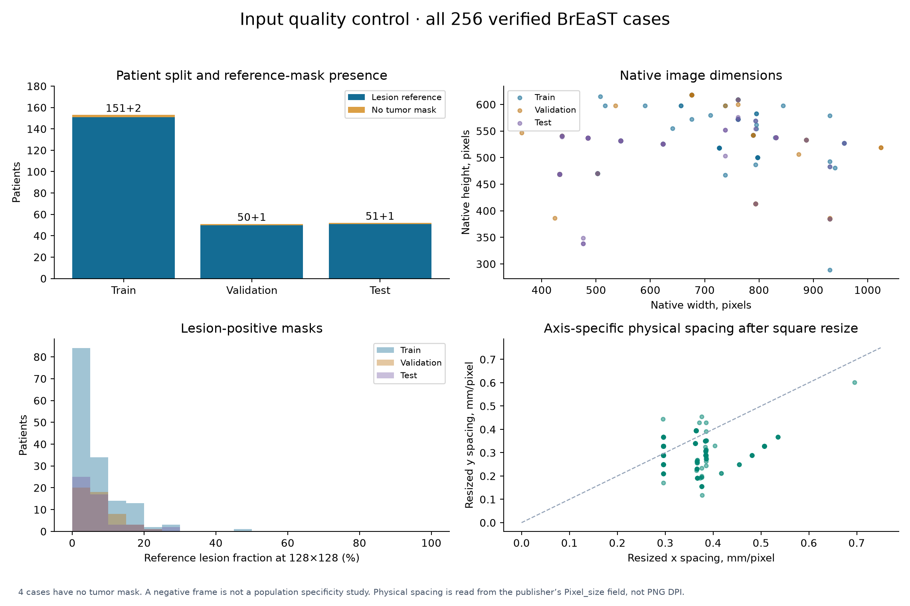

# Breast Lesion Segmentation in Ultrasound Images

Can a model mark the same part of a breast ultrasound image as an expert? This project tests **lesion segmentation**. Given a grayscale scan, each model produces a mask that marks the pixels it predicts belong to the lesion.

Green shows the expert’s boundary. Pink shows the model’s prediction. The middle row shows a difficult case. In the last row, the expert marked no lesion, but some models still marked part of the image. The examples come from the [BrEaST dataset](DATA.md).

## Results

The models trained with **16, 46, or 153 labeled patients**. Each model was tested on the same 52 other patients. Of those, 51 had a lesion with an expert mask. The table shows the average Dice score on those 51 patients when all 153 training labels were available. A Dice score of 1 means the masks match exactly. A score of 0 means they do not overlap.

| Model | Mean Dice | 95% interval |
| --- | ---: | ---: |
| Pixel logistic regression | 0.226 | 0.184–0.272 |
| Random forest | 0.485 | 0.428–0.547 |
| U-Net | 0.685 | 0.622–0.742 |
| Fine-tuned DeepLab | 0.706 | 0.646–0.759 |

Both neural models scored higher than the random forest. With only 16 labeled patients, fine-tuned DeepLab scored 0.583 and U-Net scored 0.460. With all the labels, their scores were closer. The paired comparison leaves room for either model to perform better. Testing on another patient cohort would show how well these results carry over.

The timing panel measures the model on one image already in memory. The reports give scores for every model, including DeepLab trained from scratch and U-Net trained without image augmentation. [Neural model results](results/neural/REPORT.md) · [Classical model results](results/pilot/REPORT.md) · [Paired comparisons](results/neural/ANALYSIS.md)

## System architecture

Across the top, the bright parts of the score map show where DeepLab predicts a lesion. Applying the validation cutoff produces the white mask on the right. The scan comes from [BrEaST](DATA.md).

Each patient appears in one group. Training patients supply examples. Validation patients help select the model checkpoint and the cutoff for turning its output into a mask. Test patients supply the final comparison with the expert.

## How the models make a mask

U-Net combines fine image detail with features learned at lower resolutions. DeepLab looks for features at several scales, then maps its prediction back to the image grid. Both return one score per pixel. [Model settings](NEURAL_PROTOCOL.md) · [Model code](study/networks.py)

## Where the models missed lesions

A model can return an empty mask even when the expert marked a lesion. With all training labels, fine-tuned DeepLab did this twice in 153 predictions. Those predictions came from three training runs on the same 51 patients. Each dot on the right represents one patient’s average across the three runs.

## Ultrasound data

BrEaST provides one scan per patient. Images and masks were resized to 128 × 128 pixels. Measurements in millimeters use the pixel size supplied with each scan. Fine details can be lost at this resolution. [Data source and license](DATA.md) · [How distances were calculated](GEOMETRY_AUDIT.md)

Ultrasound examples are adapted from Pawłowska et al., BrEaST, under CC BY 4.0. The images were resized and the masks were added for comparison. [Original dataset](https://doi.org/10.7937/9WKK-Q141)

## Installation and use

Choose your system for the requirements, install commands and first run.

- [Windows with PowerShell](MANUAL.md#windows)
- [macOS](MANUAL.md#macos)
- [Ubuntu and other Linux distributions](MANUAL.md#linux)

To explore the published results, open the images and tables above. To run your own comparison, follow the [setup and run guide](MANUAL.md). The [verification record](VALIDATION.md) describes the checks behind the saved results.
